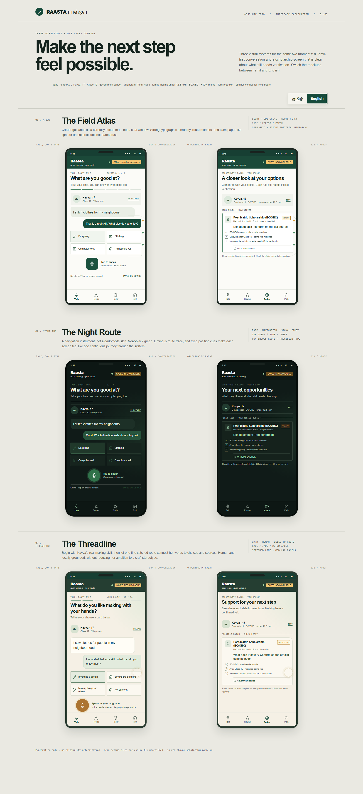
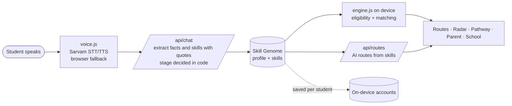

<div align="center">


# Raasta · ராஸ்தா

### Google Maps for careers, for rural India.

A student **talks in her own language**. Raasta works out what she is already good at, shows **career routes that grow from those skills**, checks **which scholarships she may qualify for, rule by rule, with official sources**, builds a **week-by-week pathway**, and gives her family a **voice note** they can understand.

**[▶ Open the live app](https://raasta-poc.vercel.app)** &nbsp;·&nbsp; Tamil · English · हिंदी · മലയാളം &nbsp;·&nbsp; Works offline


*Team Absolute Zero · SRM Institute of Science and Technology, Chennai · Citi India Hackathon (Ada Lovelace Day), Round 2*

</div>

---

## The problem

A 17-year-old in Villupuram stitches clothes for her neighbours. She has never thought of it as a *skill*. Nobody has told her that it can lead to an ITI course, a garment-unit apprenticeship with a stipend, or a fashion-technology diploma, and that she may qualify for support to get there.

Career guidance in India is mostly in English, mostly for city students, and mostly a form that asks *"What do you want to become?"*. Raasta asks *"What do you already do?"* instead.

<div align="center">

</div>

## What it does

| | |
|---|---|
| 🎙️ **Talk, don't type** | An adaptive voice conversation in Tamil, English, Hindi or Malayalam. Raasta follows what the student actually says, gently re-asks once when an answer is unclear, respects "I'd rather not say", and stops with a clear *"your roadmap is ready"*. |
| 🧬 **Skill Genome** | Free-text skills ("dances at temple festivals", "fixes mixies for neighbours", "raises goats") are captured as the student speaks and mapped to skill families, so matching works even for answers no form would have offered. |
| 🧭 **Your Routes** | Career routes built from the student's own skills, by AI when online and from a 17-career catalogue on the device when offline. Each route has photos and videos of real people doing the job. |
| 📡 **Opportunity Radar** | Scholarship and training eligibility, checked rule by rule on the device: ✓ met, — not met, ? missing. A "maybe" tells you *exactly* which answer is missing. Every scheme links to its official source and is clearly labelled as unverified demo data. |
| 🗺️ **My Pathway** | A week-by-week plan with links to official course sites (SWAYAM, Skill India Digital, NIOS, Apprenticeship India and others). |
| 👪 **Parent Mode** | Its own tab, written for the family in their language: what the student is good at, one route with its first steps, support they may qualify for (with official links), papers to keep ready, and three things to do this week. Every section can be read aloud, there is a voice note built from the student's own data in about 60 seconds (Nandana's script builder; pre-recorded in Tamil for Kavya), and the summary can be shared on WhatsApp. |
| 🏫 **School view** | A teacher sees every student who used the shared school phone, by name: skills, top route, possible schemes, who needs a closer look, and who hasn't started. |

## Two versions, one app

The live app opens in **Field Atlas**, the current design. **Classic** is the earlier interface from the same day, kept as a fallback. It runs inside the same phone frame and uses the same AI and voice.

- **Desktop:** use the **App: Field Atlas | Classic** switch in the left panel.
- **Phone:** tap **⇄ Classic version** on the first screen, and **⇄ Field Atlas** to come back.
- **Direct link:** [raasta-poc.vercel.app/?classic](https://raasta-poc.vercel.app/?classic)

## Built on honesty

- **No invented facts.** Profile facts are kept only if the student's own words back them up. The model has to quote them.
- **No guessed matches.** With no skills known, Raasta asks instead of guessing. Unknown information is never treated as failed.
- **No made-up money.** No salary figures are shown. Scheme benefits say *"demo detail, verify"*.
- **Every scheme is marked unverified** until a person checks it against the official page.

## How it works



| Layer | What it is |
|---|---|
| **App** | Installable PWA in plain JavaScript, no build step. Network-first service worker, so it works offline after the first visit. The Classic version lives in `aira/app/classic/`. |
| **Rules engine** | `engine.js` runs on the device. Every eligibility rule is JSON (`field`, `op`, `value`, `text`) with an official source link. |
| **AI** | Sarvam AI (`sarvam-105b-conversations`) via Vercel serverless functions. The API key stays on the server, with an origin allow-list and a per-IP rate limit. |
| **Voice** | Sarvam `saaras:v4` speech-to-text and `bulbul:v3` text-to-speech. Daily per-device budget, Stop button, falls back to the browser's own voice. |
| **Data** | 17 careers and 7 opportunities, every string in 4 languages. |

## Try it in 60 seconds

1. Open **[raasta-poc.vercel.app](https://raasta-poc.vercel.app)** and pick **தமிழ்**.
2. On a laptop, use the demo deck in the left panel: **Kavya** (stitching) or **Murugan** (phone repair) jump straight to results, **Talk live** starts a real voice conversation, and **Reset** clears everything. On a phone, tap **Presenter demo: Kavya** or **New student**.
3. Say something no form would expect, like *"I train pigeons"* or *"I fix fans for my neighbours"*, and watch the Skill Genome grow.
4. Open **Radar** to see each rule checked, **Path** for the plan, then **Parent** for the family summary and voice note.
5. **Teacher login** on the same phone shows the class.

## Run locally

```bash
python -m http.server 5173 --directory aira/app      # static app (voice falls back to the browser)
node aira/app/tests/run-all.js                         # 60 tests, no network, Sarvam is mocked
```

The AI and voice features need `SARVAM_API_KEY` set in the Vercel project environment. Keys are never committed.

## Repository

| Path | What's inside |
|---|---|
| [`aira/app/`](aira/app) | **The live app**: UI, rules engine, data, voice, accounts, serverless API, tests |
| [`aira/audit/`](aira/audit) | Product and logic audit, plus the engineering changelog |
| [`aira/design/`](aira/design) · [`aira/screenshots/`](aira/screenshots) | Design system and interface explorations |
| [`shared/prototype/`](shared/prototype) | Read-only baseline prototype |
| [`gautam/backend/`](gautam/backend) | FastAPI backend implementing the team API contract |
| [`nandana/`](nandana) | Conversation script, voice states, test personas and logs |
| [`akshaj/`](akshaj) · [`pranshu/`](pranshu) | Voice engine research · roadmap, architecture and dataset |

## Team Absolute Zero

| | Role |
|---|---|
| **Aira** | Lead · product, UI/UX, app engineering |
| **Nandana** | Conversation design, Parent Mode voice script, voice states, testing |
| **Akshaj** | Voice engine |
| **Gautam** | Backend (FastAPI) and API contract |
| **Pranshu** | Roadmap, production architecture, data |

<details>
<summary><b>Contributor rules and the team API contract</b></summary>

**Work only inside your own folder.** Nobody edits anyone else's folder or `shared/`. Never commit keys (they go in `.env`, which is git-ignored). Never make up scheme facts, statistics or quotes: every rule needs its official link.

**Voice contract:** `window.RaastaVoice = { listen(lang) → Promise<{text}>, speak(text, lang) → Promise<void> }`.

**Backend contract (Gautam):**
```
POST /api/profile/chat      {student_id, lang, message}        -> {reply_text, profile, done}
POST /api/careers/match     {profile}                          -> [{career_id, title, type, why, earning_range}]
POST /api/eligibility       {profile}                          -> [{opportunity_id, name, status, reasons:[{rule, passed, text}], benefit, deadline, source_url, last_checked}]
POST /api/pathway           {profile, career_id}               -> {weeks:[...], exams:[...], institutions:[...]}
POST /api/parent-script     {profile, career_id, lang}         -> {text}
GET  /api/facilitator/students                                 -> [{student_id, name, top_career, eligible_count, talent_flag, recommended}]
POST /api/facilitator/recommend {student_id, opportunity_id, note} -> {ok}
GET  /api/offline-pack                                         -> {opportunities, careers, version}
POST /api/stt               audio file + {lang}                -> {text}
POST /api/tts               {text, lang}                       -> audio (wav/mp3)
```
The live demo runs its own serverless endpoints (`/api/chat`, `/api/routes`, `/api/stt`, `/api/tts`, `/api/understand`, `/api/voice-status`). Aligning the two is tracked in [`aira/audit/`](aira/audit).

</details>

---

<div align="center"><sub>Made in Chennai for students whose skills deserve a map.</sub></div>
