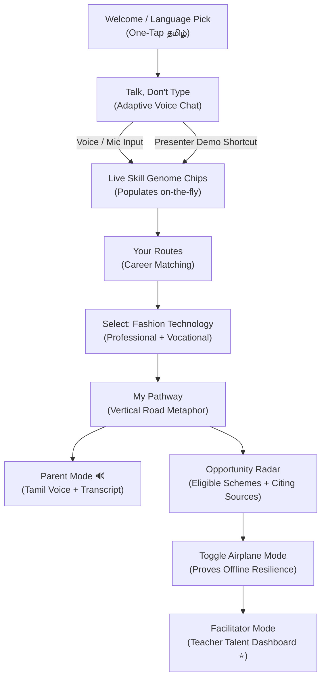

# RAASTA: UI/UX Design System & Architectural Proposal (Round 2)
**Project:** RAASTA ("Google Maps for Careers")  
**Hackathon:** Citi India Hackathon Celebrating Ada Lovelace Day  
**Author:** Aira K Salish (Lead Product Designer & Frontend Engineer)  
**Date:** 20 November 2026  
**Status:** Deliverable 1 — Design Proposal & Architecture  

---

## 1. Executive Design Philosophy: "Dignity, Clarity, Warmth"

Rural educational technology frequently falls into two traps:
1. **The Bureaucratic Trap:** Form-heavy, English-first, dense text walls with sterile government blues that intimidate first-generation learners and create anxiety.
2. **The "Toy" Trap:** Overly gamified, childish cartoon interfaces that degrade the serious aspirations of a 17-year-old looking for employment, or fail to gain the solemn trust of rural parents who hold the veto power over her education.

RAASTA rejects both. We design for **Dignity, Clarity, and Warmth**:
* **For Kavya (17, Villupuram):** A conversational, non-threatening experience that feels like an empathetic elder sister guiding her through spoken Tamil and tactile, icon-anchored choices.
* **For Her Parents:** Parent Mode speaks with respectful formality in clear regional Tamil, highlighting safety, financial relief, and government backing.
* **For the Village Teacher (Facilitator):** A scannable, dense, one-tap dashboard that works effortlessly on a shared 360px Android phone.
* **For the Citi Judges:** An uncluttered, mathematically grounded fintech/edtech experience that looks instantly legible and polished in a 4-minute laptop screen share.

---

## 2. Exploration of Visual Directions & Recommendation

We explored three distinct visual directions:

| Attribute | Direction A: "Kurinji Terra" | Direction B: "Kaveri Dawn" ⭐ *(Recommended)* | Direction C: "Bharat Slate" |
| :--- | :--- | :--- | :--- |
| **Mood** | Earthy, handloom, rustic artisan | **Warm, optimistic, modern Indian, trustworthy** | High-utility, institutional, administrative |
| **Primary Palette** | Terracotta `#C85A32`, Indigo `#1E2B37` | **Forest Emerald `#0D5C46`, Teak `#111C18`** | Cobalt `#1E3A8A`, Deep Ash `#334155` |
| **Accent & Highlight**| Ochre `#D97706`, Sand `#FAF7F2` | **Temple Sun Gold `#D97706`, Jasmine `#F8F9F7`** | Saffron `#EA580C`, Pure White `#FFFFFF` |
| **Surface Feeling** | Textured parchment & raw clay | **Crisp, clean surface with soft organic tint** | Strict sterile white cards |
| **Corner Radius** | 12px (Soft rectangular) | **16px (Human, friendly, modern PWA)** | 8px (Strict corporate utility) |
| **Judge Perception** | Risks looking like an NGO craft catalog | **Fintech-grade rigor balanced with human warmth** | Looks like standard e-Gov portal |

### Why "Kaveri Dawn" is Our Winning Direction:
* **Deep Forest Emerald (`#0D5C46` light / `#2DD4BF` dark):** Symbolizes growth, life, and financial prosperity. It departs from cliché government blue, creating an immediate feeling of freshness and hope.
* **Temple Sun Gold (`#D97706` / `#F59E0B` dark):** Represents illumination, guidance, and the **"First Rupee"** milestone. Used selectively for pathway progress and audio play moments.
* **Jasmine Parchment Background (`#F8F9F7` / `#0A110F` dark):** Eliminates harsh blue-light glare in bright rural sunlight, improving outdoor legibility while feeling warmer than sterile clinical white.

---

## 3. Design System & Component Tokens

### 3.1 Tamil-First Typography Hierarchy
Tamil script has taller ascenders, lower descenders, and complex vowel markers (கொ, தை, ளி). Setting standard English line-heights (1.2–1.3) invariably causes ugly clipping and optical vibration. 
* **Primary Font Stack:** `'Mukta Malar', 'Noto Sans Tamil', system-ui, -apple-system, sans-serif`
* **Baseline Line-Height:** `1.55` (generous vertical breathing space).
* **Typography Tokens:**
  * `text-hero`: 24px / 1.3, Weight 700 (Tamil title & welcome hero)
  * `text-h1`: 20px / 1.35, Weight 600 (Screen headers, career titles)
  * `text-h2`: 18px / 1.4, Weight 600 (Section titles, parent transcript)
  * `text-body-lg`: 16px / 1.55, Weight 500 (Chat bubbles, option cards)
  * `text-body`: 14.5px / 1.5, Weight 400 (Descriptions, rule details)
  * `text-caption`: 13px / 1.4, Weight 400 (Meta info, source citations)
  * `text-badge`: 11px / 1.2, Weight 700, Letter-spacing 0.5px (Status pills)

### 3.2 Spacing & Layout Tokens (360px Mobile-First)
* Base unit: `4px`
* Spacing Scale: `space-1 (4px)`, `space-2 (8px)`, `space-3 (12px)`, `space-4 (16px)`, `space-6 (24px)`, `space-8 (32px)`
* Container Max-Width: `420px` (centered with elegant shadow on laptop screens for live screen-share demo).
* Minimum Tap Target: `48px` $\times$ `48px` (strict adherence to mobile ergonomics for coarse touch).

### 3.3 Semantic Color Tokens (Light & Dark Mode)
```css
:root {
  /* Surface & Base */
  --bg-app: #F8F9F7;
  --bg-card: #FFFFFF;
  --bg-card-subtle: #F1F5F3;
  --border-subtle: #E2E8E5;
  --border-focus: #0D5C46;
  
  /* Typography */
  --ink-primary: #111C18;
  --ink-secondary: #526861;
  --ink-tertiary: #879B95;
  --ink-inverse: #FFFFFF;

  /* Brand Colors */
  --brand-primary: #0D5C46;
  --brand-surface: #E6F4F0;
  --brand-hover: #094736;
  
  /* Accent & Action */
  --accent-gold: #D97706;
  --accent-gold-soft: #FEF3C7;
  
  /* Status Semantics */
  --status-eligible-bg: #DCFCE7;
  --status-eligible-ink: #15803D;
  --status-not-eligible-bg: #FEE2E2;
  --status-not-eligible-ink: #B91C1C;
  --status-maybe-bg: #FEF3C7;
  --status-maybe-ink: #B45309;

  /* Elevation */
  --shadow-sm: 0 1px 3px rgba(17, 28, 24, 0.05);
  --shadow-md: 0 4px 12px rgba(17, 28, 24, 0.08);
  --shadow-lg: 0 12px 28px rgba(17, 28, 24, 0.12);
}

@media (prefers-color-scheme: dark) {
  :root:not([data-theme="light"]) {
    --bg-app: #0A110F;
    --bg-card: #131E1B;
    --bg-card-subtle: #1A2824;
    --border-subtle: #223530;
    --border-focus: #2DD4BF;
    
    --ink-primary: #EBF2EE;
    --ink-secondary: #97ADA6;
    --ink-tertiary: #617770;
    
    --brand-primary: #2DD4BF;
    --brand-surface: #10332B;
    --brand-hover: #14B8A6;
    
    --accent-gold: #F59E0B;
    --accent-gold-soft: #38270A;

    --status-eligible-bg: #0E351F;
    --status-eligible-ink: #4ADE80;
    --status-not-eligible-bg: #3B1414;
    --status-not-eligible-ink: #F87171;
    --status-maybe-bg: #38270A;
    --status-maybe-ink: #FBBF24;
  }
}
```

### 3.4 Iconography Strategy: Hybrid SVG + Pictogram Architecture
* **System & Action Controls:** Crisp, clean inline SVG vectors (1.75px stroke width, rounded joins) for mic, navigation, verified badges, external links, and checkmarks. Guarantees 100% pixel fidelity on any device.
* **Option Anchors:** High-recognition emoji pictograms paired strictly with localized bold text inside tactile cards (e.g. `🧵 தையல் (Stitching)`). This prevents ambiguity while respecting low-literacy cognitive load.

---

## 4. End-to-End Information Architecture & Flow Map



### Screen Flow Details:
1. **Welcome Screen:** 
   - Prominent language selection cards with audio greeting ("வணக்கம்! தொடங்குவோம்").
   - Single tap enters conversational onboarding.
2. **Talk, Don't Type Screen:**
   - Chat feed displaying conversational bot prompts.
   - Distinctive 68px Mic Action Button with 3 visual feedback states:
     - `Idle`: Soft emerald glow with microphone icon.
     - `Listening`: Coral-red pulsing concentric rings.
     - `Thinking`: Warm gold spinner.
   - 3-column / 2-column tactile option buttons with big touch areas.
   - Dynamic Genome summary drawer at top/bottom showing collected skills.
   - Subtly positioned "▶ Demo: Kavya" button for presenter fail-safe.
3. **Your Routes Screen:**
   - Respected career cards clearly labeling `Vocational`, `Emerging`, and `Professional`.
   - Clear earnings range (`₹15,000-30,000/மாதம்`) and direct rationale (*"You already stitch for neighbours..."*).
   - "See Pathway (பாதையைப் பார்)" button.
4. **My Pathway Screen:**
   - Designed visually as a vertical "Raasta" (winding road with milestones).
   - Week 1-2, Week 3-4 steps connecting to SWAYAM, NIFT, and local ITIs.
   - Prominent "Parent Mode" card with a golden play button.
5. **Parent Mode Audio:**
   - Large audio visualization waves with high-contrast playback controls.
   - Prominent, large-text Tamil transcript ensuring full transparency.
6. **Opportunity Radar Screen:**
   - Grouped cards: `Eligible` (Green), `Maybe` (Amber), `Not Eligible` (Muted/Red).
   - Benefit amount emphasized in large bold numbers (`₹1,000/மாதம்`).
   - Every rule checked with explicit reason (`✅ அரசுப் பள்ளி`, `❌ 9-10 வகுப்பு மட்டுமே`).
   - Verified badge (`🛡️ Verified by Dept of Social Welfare`) and clickable official URL.
7. **Facilitator Mode Screen:**
   - Responsive table/card grid of village students.
   - Highlights Kavya with ⭐ Talent Flag.
   - One-tap "Recommend" button that updates state immediately with tactile confirmation.
8. **Global Offline & Navigation Shell:**
   - Persistent bottom navigation bar with 5 clear touch targets.
   - Calming offline pill banner: `✈ ஆஃப்லைன்: சேமிக்கப்பட்ட விவரங்கள் செயல்படும்` (Offline: Saved info works).

---

## 5. Micro-Interactions & Cognitive Feedback

1. **The Mic Pulse:** When the user taps the mic, a rhythmic CSS ripple animation expands outward, indicating active listening without requiring audio feedback.
2. **Genome Pop-In:** When a skill is identified, a new chip springs into the Skill Genome bar with a gentle CSS bounce (`cubic-bezier(0.34, 1.56, 0.64, 1)`).
3. **Roadmap Step Reveal:** As the user scrolls through the Pathway, milestones illuminate sequentially along the vertical route.
4. **Motion Accessibility:** All animations are wrapped in `@media (prefers-reduced-motion: reduce)` to disable layout shifts for sensitive users or underpowered low-end GPUs.

---

## 6. Technical Stack Decision: Pure Vanilla PWA Architecture

* **Decision:** We implement this directly in **Vanilla Modern ES6 + CSS Variables + SVG** in `aira/app/`.
* **Technical Justification:**
  1. **Instant First Paint (<150ms):** Zero JavaScript bundle overhead, zero React hydration lag on a ₹5,000 phone with 2GB RAM.
  2. **Zero Build Step Dependency:** No Vite/Webpack build failures, allowing rapid iterative polish right up to the Saturday 9 PM feature freeze.
  3. **Seamless Offline Service Worker:** Direct precaching of HTML, CSS, SVG, and JS assets without complex PWA workbox compilation.
  4. **Contract Fidelity:** 100% preservation of `engine.js` logic and `data.js` schemas.
